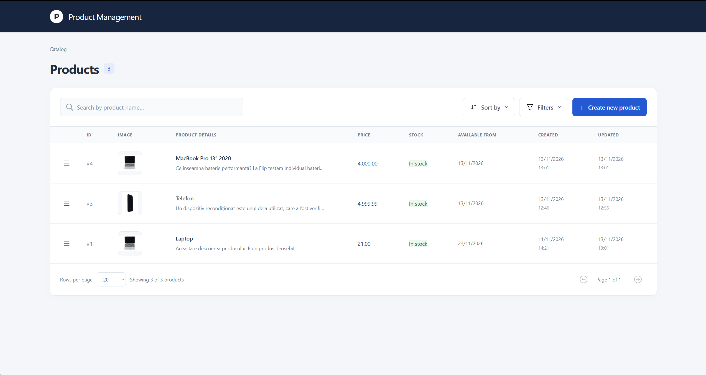
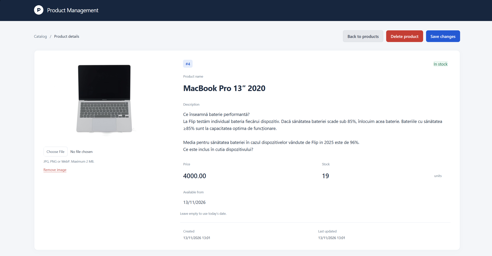
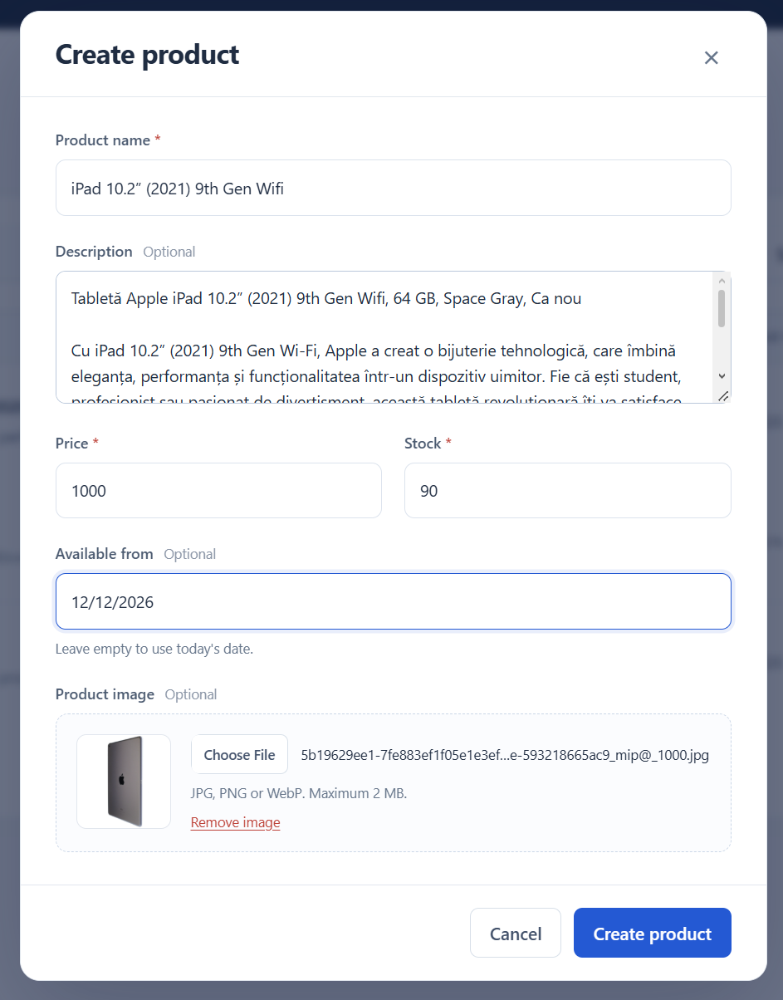
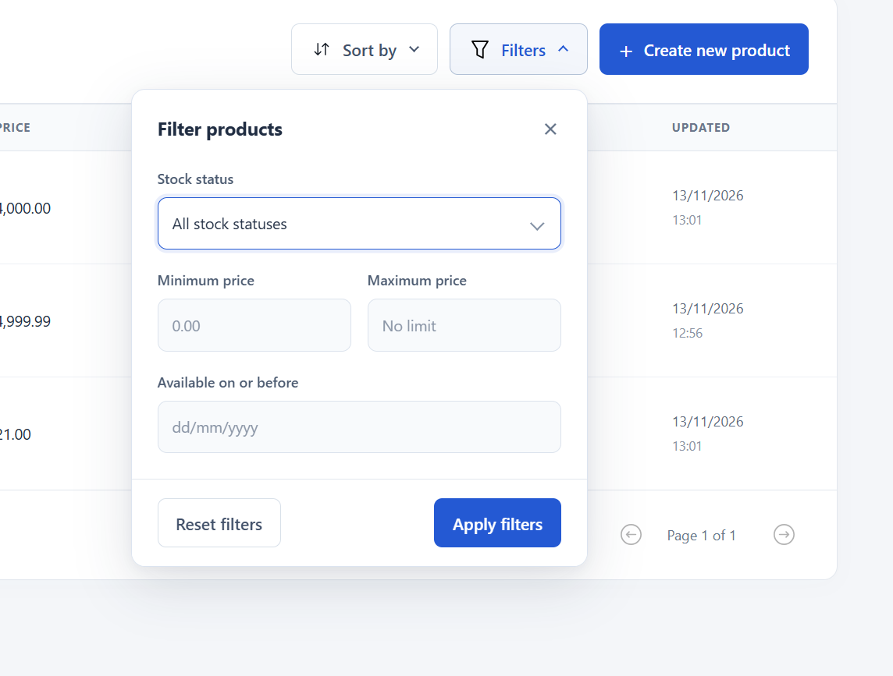
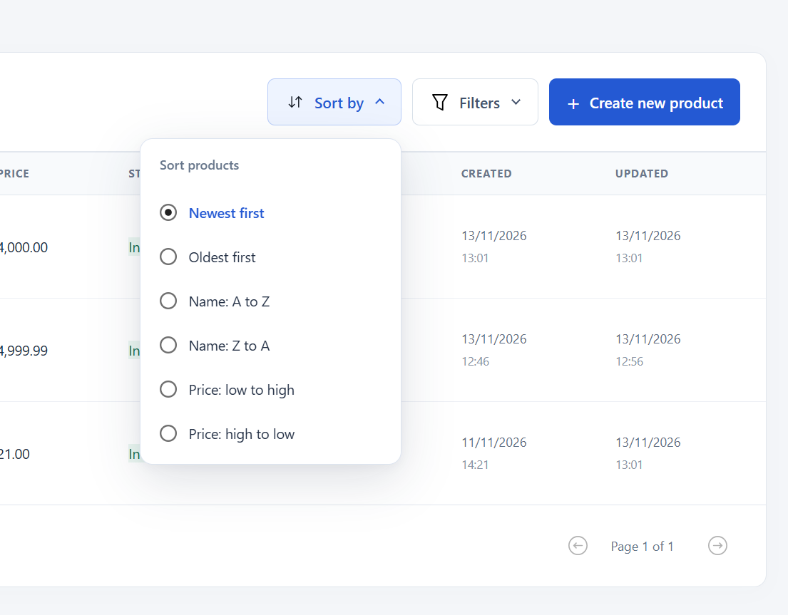
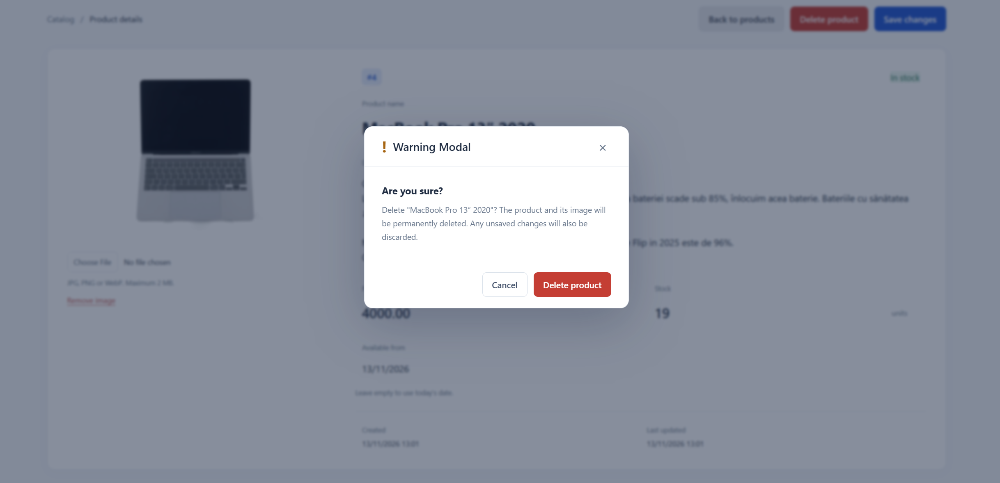

# Product Management

A web application for managing a product catalog, built with **PHP, MySQL, and vanilla JavaScript**, featuring a responsive HTML/CSS interface without a frontend framework.

The application provides product management functionality, including creating, editing, and deleting products, image uploads, inventory tracking, searching, filtering, sorting, and pagination.

## Features

- **Search:** Search products by name with a 350 ms debounce to reduce unnecessary requests.
- **Filtering:** Filter products by price range, stock availability, and availability date.
- **Sorting:** Sort products by name, price, or creation date in ascending or descending order.
- **Pagination:** Choose between 10, 20, 50, or 100 products per page.
- **Product creation:** Add products through a modal form with field validation and image preview.
- **Inline editing:** Update product details and stock quantities directly from the product details page.
- **Quick actions:** Access edit and delete options through a row action menu, or open a product by double-clicking its detail cells.
- **Confirmation dialogs:** Prevent accidental deletions and loss of unsaved changes.
- **Toast notifications:** Display feedback for successful operations and errors.
- **Authentication:** Secure both the dashboard and API using HTTP Basic Authentication.

### Product Catalog



### Product Details



<details>
<summary>Product creation, filtering, sorting, and confirmation dialogs</summary>

**Create Product**



**Product Filters**



**Product Sorting**



**Unsaved Changes Confirmation**



</details>

## Installation and Setup

Run the following commands from the project's root directory.

### 1. Install Dependencies

Install the PHP dependencies using Composer:

```shell
composer install
```

### 2. Configure Environment Variables

Create a `.env` file by copying `.example.env`.

Update the `.env` file with your database connection details and dashboard credentials.

Replace the example values with the credentials for your local environment.

### 3. Create the Database and Run Migrations

Create the database in MySQL or MariaDB:

```sql
CREATE DATABASE product_manager
    CHARACTER SET utf8mb4
    COLLATE utf8mb4_unicode_ci;
```

Apply the database migrations:

```shell
composer phinx -- migrate -e development
```

Database migrations are managed using **Phinx**.

- Migration configuration: `phinx.php`
- Migration files: `database/migrations/`

A newly created database does not contain sample products. Products can be added directly through the application interface.

### 4. Start the Application

For local development, start PHP's built-in web server:

```shell
php -S 127.0.0.1:8000 -t public public/router.php
```

Open the application in your browser:

**http://127.0.0.1:8000**

When prompted, enter the credentials configured in `DASHBOARD_USERNAME` and `DASHBOARD_PASSWORD`.

### Apache / Laragon Setup

- Configure the document root to point to the `public/` directory.
- Ensure Apache's `mod_rewrite` module is enabled.

Application routing is configured in `public/.htaccess`.


## Usage

The application provides two main views:

- **Product Catalog:** `/`
- **Product Details:** `/products/{id}`

### Managing Products

**Creating a product**

Click **Create new product** to open the creation form.

- Product name and price are required.
- The initial stock quantity defaults to `0`.
- An image can be uploaded and previewed before submission.

**Searching and filtering**

Use the search field to find products by name.

- Search requests are debounced by 350 ms.
- Select the desired filters and click **Apply filters**.
- Use **Sort by** to immediately apply the selected sorting option.

**Editing and deleting products**

Each product row includes an **Actions** menu with the following options:

- **Edit product**
- **Delete product**

You can also open the product details page by double-clicking the product information cells.

On the product details page, click an editable value to modify it.

Click **Save changes** to save your updates and return to the catalog, where a success notification will be displayed.

Confirmation dialogs help prevent accidental deletions and the loss of unsaved changes.

### Product Images

Supported image formats:

- JPG / JPEG
- PNG
- WebP

**Maximum file size:** 2 MB

Products without an uploaded image display a default placeholder.

### Date Handling

Dates are displayed and entered in the interface using the **`dd/mm/yyyy`** format.

If the availability date is left empty when creating a product, it defaults to the current date in the **Europe/Bucharest** timezone.

When updating a product:

- Explicitly submitting an empty value or `null` resets the availability date to the current date.
- Omitting the field preserves the existing availability date.

## REST API

The application exposes a REST API for managing products.

All API endpoints use the same **HTTP Basic Authentication** credentials as the dashboard.

Dates are exchanged through the API using the ISO **`yyyy-mm-dd`** format. The frontend handles date conversion for display and input.

### Endpoints

| Method | Endpoint | Description | Request Body |
|---|---|---|---|
| `GET` | `/api/products` | List, search, filter, sort, and paginate products | — |
| `GET` | `/api/products/{id}` | Retrieve product details | — |
| `POST` | `/api/products` | Create a new product | `multipart/form-data` |
| `PATCH` | `/api/products/{id}` | Update product fields or remove an image | `application/json` |
| `POST` | `/api/products/{id}` | Update a product with a new image | `multipart/form-data` |
| `DELETE` | `/api/products/{id}` | Delete a product | — |

### Request Headers

Create and update requests require the following header:

```http
X-Requested-With: XMLHttpRequest
```

If an `Origin` header is provided, it must match the application's origin.

The frontend API helper, located at `public/assets/js/api.js`, handles the required headers and authentication credentials.

For `FormData` requests, the browser automatically sets the `Content-Type` header and multipart boundary.

### Product Listing Parameters

The `GET /api/products` endpoint supports the following query parameters:

| Parameter | Description |
|---|---|
| `page` | Page number. Defaults to `1`. |
| `per_page` | Number of products per page, from `1` to `100`. Defaults to `20`. |
| `search` | Partial product name search, up to 255 characters. |
| `min_price` | Minimum price, supporting up to two decimal places. |
| `max_price` | Maximum price, supporting up to two decimal places. |
| `in_stock` | Filter by stock availability: `true` or `false`. |
| `available_on` | Include products available on or before the specified ISO date, as well as products without an availability date. |
| `sort_by` | Sort by `created_at`, `name`, or `price`. Defaults to `created_at`. |
| `sort_direction` | Sorting direction: `asc` or `desc`. Defaults to `desc`. |

### Product Updates

Update requests only need to include the fields being modified.

Product IDs and creation/update timestamps are managed automatically by the application.

### API Responses

All API responses follow a consistent JSON structure.

**Successful response:**

```json
{
  "success": true,
  "data": {}
}
```

**Error response:**

```json
{
  "success": false,
  "error": {
    "code": "...",
    "message": "..."
  }
}
```

Validation errors return HTTP status **422 Unprocessable Entity** and may include field-specific error messages in `error.details`.

Successful product listing responses include:

- `data.items` — the list of matching products.
- `data.pagination` — pagination metadata.

## Project Structure

The application follows a layered architecture, separating HTTP request handling, business logic, and database access.

```text
config/                  Application bootstrap, environment
                         configuration, and PDO connection
database/migrations/     Database schema migrations (Phinx)
lang/                    API messages
public/                  Web pages and HTTP entry points
  assets/css/            Page and component styles
  assets/js/             Frontend logic and API helper
  assets/images/doc/     Documentation screenshots
  components/            Reusable PHP UI components
  uploads/products/      Uploaded product images
src/
  Controllers/           Product request handlers
  DTO/                   Request validation and response structures
  Http/                  API routing and JSON responses
  Middleware/            Authentication and request validation
  Repositories/          Database queries using PDO
  Services/              Product operations and image storage
  Support/               Image validation, date handling, and translations
```

This structure keeps the codebase organized and makes individual components easier to maintain and extend.
